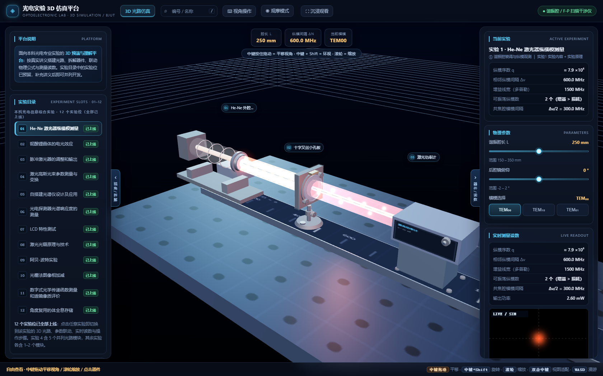
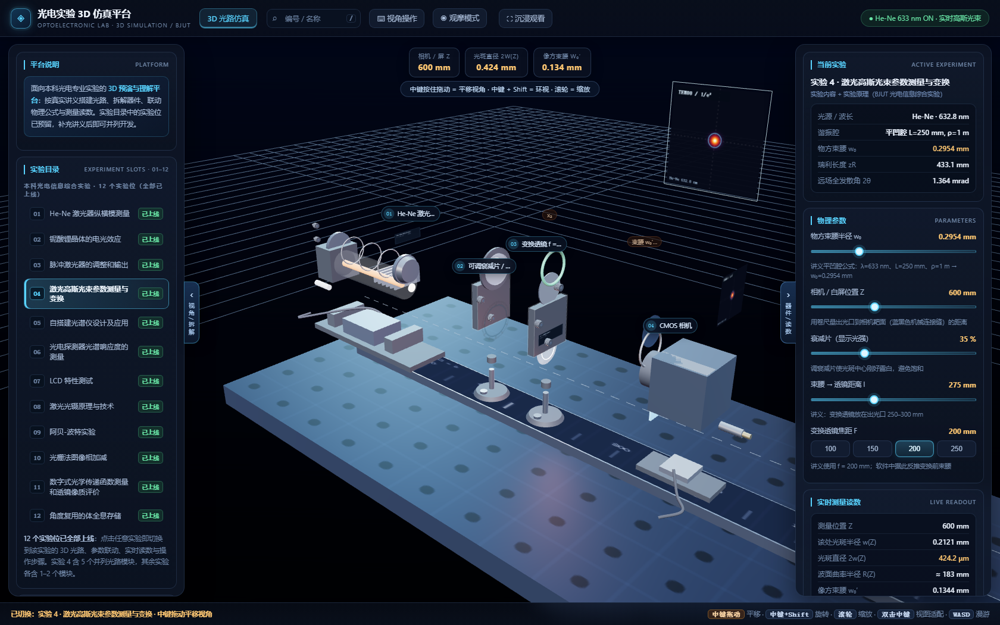

# 光电实验 3D 仿真平台

面向光电信息类专业本科实验教学的浏览器端三维仿真平台。**零依赖、单文件、纯前端** —— 一个 `index.html` 就是全部，双击即可运行。



## 特点

- **零依赖**：原生 JavaScript + WebGL，无框架、无 CDN、无 npm、无构建步骤
- **单文件**：全部 HTML / CSS / JS 在同一个 `index.html` 内，便于分发、离线使用和二次修改
- **配置驱动**：以「实验 — 模块 — 器件 — 参数」四级模型描述实验知识，新增实验只需追加配置，无需改动引擎
- **物理内核**：基于 q 参数的高斯光束传播（ABCD 矩阵 + 束腰变换），读数实时复算
- **可拆解**：任意器件支持爆炸拆解，观察内部结构



## 快速开始

```bash
git clone <仓库地址>
cd optical-lab-3d
```

直接用浏览器打开 `index.html` 即可。若需通过 HTTP 访问：

```bash
python -m http.server 8000
# 打开 http://localhost:8000
```

也可直接开启 GitHub Pages（Settings → Pages → 选 `main` 分支根目录），无需任何构建配置。

## 包含的实验

| # | 实验 | # | 实验 |
|---|---|---|---|
| 1 | He-Ne 激光器纵横模测量 | 7 | LCD 特性测试 |
| 2 | 铌酸锂晶体的电光效应 | 8 | 激光光镊原理与技术 |
| 3 | 脉冲激光器的调整和输出 | 9 | 阿贝-波特实验 |
| 4 | 激光高斯光束参数测量与变换 | 10 | 光栅法图像相加减 |
| 5 | 自搭建光谱仪设计及应用 | 11 | 数字式光学传递函数测量与透镜成像质量评价 |
| 6 | 光电探测器光谱响应度的测量 | 12 | 角度复用的体全息存储 |

## 操作

| 操作 | 说明 |
|---|---|
| 左键拖动 | 平移视角 |
| 中键拖动 | 平移视场 |
| 滚轮 | 缩放 |
| 双击器件 | 查看器件规格 |
| `[` `]` | 拆解 / 复位所选器件 |
| `\` | 沉浸观看（收起左右面板） |
| `F` | 打印标定 |

## 技术说明

- 渲染：WebGL（无第三方引擎），器件几何由参数化构建
- 物理：q 参数高斯光束，`lensTransform()` / `optics()` / `wAt()` 构成传播内核
- 数据：实验、模块、器件、参数四级配置，读数以 `{rows, hud, chart, spot}` 四元组统一输出
- 兼容：Chrome / Edge / Firefox / Safari 近两年版本

## 许可

[MIT](LICENSE) © 2026 袁圣博
